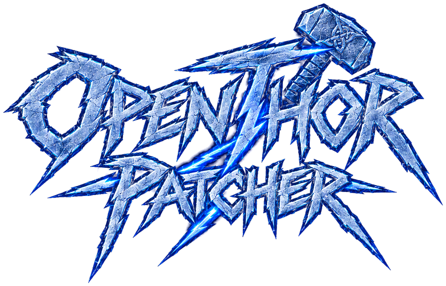
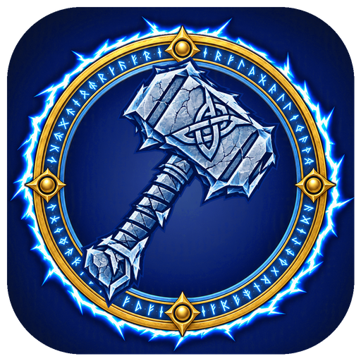

# OpenThor Patcher

<p align="center">
  
</p>

> _A free, fast and stable patcher for Ragnarok Online clients: the open successor of Thor Patcher and NeonCube._

**Windows · macOS** (CLI and core also Linux) · **Rust + Tauri 2** · **MIT or Apache-2.0** · **v0.1.0 (pre-release)**

<p align="center">
  
</p>

<p align="center">
  <a href="https://github.com/kxdrsrt/OpenThorPatcher/releases"></a>
  <a href="https://github.com/kxdrsrt/OpenThorPatcher/actions/workflows/ci.yml"></a>
  <a href="#license"></a>
</p>

<p align="center">
  <a href="https://github.com/sponsors/kxdrsrt"></a>
  <a href="https://ko-fi.com/kadirsert"></a>
  <a href="https://opencollective.com/kxdrsrt"></a>
  <a href="https://www.patreon.com/cw/kxdrsrt"></a>
  <a href="https://liberapay.com/kxdrsrt/"></a>
</p>

## Status: pre-release, not production-ready yet

**v0.3.0 is a pre-release.** The core, the CLI, the MCP server and both apps work and are tested (unit tests, the
end-to-end script `tests/e2e.sh` with plain and encrypted GRFs, a tampered patch list, a broken download, file removal and
the classic `plist.txt` layout, and a run against a real 2.5 GB `data.grf`). It is **not** a stable production version:

* **Nobody has clicked through the two apps yet.** The Patcher ran in a Windows 11 virtual machine (x64 emulation) against a
  local test server, the user interface logic was tested with a scripted DOM.
* **Not tested on a real player PC:** slow connections, antivirus scanners and locked files are unknown territory.
* **The `.exe` files are not code-signed**, so Windows SmartScreen shows "unknown publisher".
* **No installer:** the first patcher goes into your client package; from then on it **updates itself** (0.2.0).
* **Cloud links** (Google Drive, Dropbox, OneDrive) and **private GitHub/GitLab repositories** are only tested with local
  stand-ins; **MEGA** was also tested against the live service. Check every link with `otp fetch`.
* Done since 0.1.0: the OdinGuard hook (M6), signed self-update (M7), parallel downloads and a bandwidth limit (M8),
  MEGA links, MidgardCP news and online count (M9). Planned: installers, languages, binary deltas.

A stable **v1.0** needs a test on real player machines and signed binaries. Details and the full list:
[docs/ROADMAP.md](docs/ROADMAP.md).

Three programs and one library:

| | For | What it is |
|---|---|---|
| **OpenThor Patcher** (`apps/patcher`) | players | The window that keeps a client up to date: news, progress, *Play*, *Check files*, optional packs on/off |
| **OpenThor Patch Maker** (`apps/maker`) | operators | Point it at your *master client*; it works out what changed and writes the patch site |
| **`otp`** (`crates/otp-cli`) | operators, CI | The same from the command line (`otp publish`, `otp patch`, `--dry-run`, `--json`) |
| **`otp-mcp`** (`crates/otp-mcp`) | AI assistants | An [MCP](docs/MCP.md) server: set up, preview and publish a patch site by asking |
| `otp-core` | everyone | The library under all of them |

## How it works (short)

```
 operator                                              player
 ┌──────────────┐  otp publish    ┌───────────────┐   ┌──────────────┐
 │ master client│ ──────────────► │  patch site   │ ◄─│ OpenThor     │
 │ (you edit it)│  only the diff  │ patchlist.json│   │ Patcher      │
 └──────────────┘                 │ patches/*.thor│   └──────────────┘
                                  │ files/…       │   merges into the GRF,
                                  └───────────────┘   verifies, swaps atomically
```

1. You keep **one master client** up to date (change a map, add a texture, delete a file).
2. `otp publish` (or the Patch Maker) compares every entry of your big GRFs with what you published last time and writes
   **only the difference** as a numbered `.thor` patch. Small files (a 3 MB `odin.grf`, a dll) are synced whole by hash.
   Nobody names or numbers patches by hand.
3. The patch list (`patchlist.json`, signed with Ed25519) says what exists. Upload the **site folder** to any static
   host, or to a cloud drive ([hosting options](docs/HOSTING.md)).
4. The player's patcher downloads what it is missing (resumable, mirrors, SHA-256), merges patches **into the GRF**
   (also encrypted GRFs), deletes what you removed, writes `DATA.INI` (with optional packs the player can switch) and
   starts the game.

Changing **one map file** means one small `.thor` containing that file, not a 2.5 GB download. Measured on the real
2.5 GB client `data.grf` (202,355 entries): publishing the baseline hashes everything in 36 s, a publish with 4
changes writes a 166-byte patch, applying it takes 12 s of disk work (a new 2.5 GB GRF is written, checked, and
swapped in; the old file is **replaced completely**, a `.bak` only stays with `--keep-backup`; for a moment both exist, so a 2.5 GB GRF needs 2.5 GB free), and a start without changes takes 0.0 s.

## Why it is better

[docs/COMPARISON.md](docs/COMPARISON.md) has the full table against Thor Patcher, NeonCube and rpatchur. The short list:

- **Diff publishing:** a master-client workflow instead of hand-made, hand-numbered patches.
- **Removal everywhere:** entries inside GRFs (Thor delete directives), loose files and whole folders.
- **Integrity:** per-file SHA-256, signed patch list, a damaged download never replaces anything, a damaged GRF is
  repaired from a full copy, the merged GRF is checked before it is swapped in.
- **GRF 0x102–0x300 and GRF Editor encryption** (the GRF code of [RustyGRF](https://github.com/kxdrsrt/RustyGRF) is
  included as a vendored copy in `vendor/rgrf-core` and linked into the program: no RustyGRF, no network and no other
  tool is needed to build or run OpenThor).
- **Still `.thor`:** reads every Thor patch and the classic `plist.txt` server layout, so an existing patch server works
  unchanged (merge patches and loose-file patches).
- **Several sources, one master version:** the patch list is read from every source you give, the newest valid one wins, a stale or dead mirror changes nothing, a client never rolls back, every file is checked by SHA-256 (see [docs/HOSTING.md](docs/HOSTING.md)).
- **Hosting freedom:** static host, S3/R2, GitHub Releases, **GitHub / GitLab repositories** (`gh:owner/repo@main`, `gl:group/project@main`, private ones with a read-only token), Google Drive / Dropbox / OneDrive share links or **MEGA file links** (decrypted on the fly, resumable). See [docs/HOSTING.md](docs/HOSTING.md).
- **Big base files stay outside:** `data.grf` (gigabytes) is only a hash and download links (MEGA, a release, your server) in the list; `otp package` makes the new-player ZIP without it, and the patcher fetches it on the first start. The master client stays on your computer.
- **Upload from the Maker:** site, client package and external files go to your server (SFTP), R2/S3, MEGA, Google Drive, Dropbox, OneDrive (all through rclone) or a GitHub release; the patch list is always uploaded last.
- **English and German:** the player window follows Windows (or the player's choice), news and changelog can be written per language, more languages come as a file in the server's theme folder; see [docs/THEMES.md](docs/THEMES.md#languages).
- **A server move without losing players (0.6.2):** the signed patch list can name other addresses of the patch site (`sites`); players' patchers remember them and use them when the old address stops answering. See [docs/HOSTING.md](docs/HOSTING.md#moving-the-patch-site-to-another-address-server-move-062).
- **One patcher at a time (0.6.1):** starting `openthor.exe` while it already runs does not open a second window: the running one comes to the front (also from the taskbar, also when minimized) and its taskbar button flashes. A self-update waits for the old process to end, so the new patcher never meets the old one's lock.
- **Play, once:** Play installs pending updates first, ignores repeated clicks and can limit how many game windows run (`max_instances`). Each start carries a launch ticket, so a guard such as OdinGuard can refuse a game started without the patcher (see [docs/FORMATS.md](docs/FORMATS.md#6-starting-the-game-launch-ticket-040)).
- **Fast and polite:** up to 4 downloads at the same time (configurable) and an optional bandwidth limit for all of them together.
- **Self-update:** the signed patch list can offer a newer patcher; it replaces itself before patching (SHA-256 checked, never loops on a wrong build).
- **MidgardCP:** news written once in the web panel arrive in the signed patch list at every publish; the patcher shows the realm's players online.
- **Player window:** Website button, link buttons with icons (Discord, forum, GitHub …), login/char/map server status dots, a big Play button and **RO Setup**.
- **Themes, news and changelog:** the player window is a themeable folder (default: a Ragnarok-style night-blue theme with the logo sticking out of the window); news and changelog are written in the Patch Maker and travel in the signed patch list.
- **Optional packs** (for example OdinGuard's competitive pack) with a per-player switch that survives patching.
- **Scriptable and AI-ready:** CLI with `--json`, and the `otp-mcp` MCP server (13 tools: create the project, preview, publish, package, upload, write news, set servers and links) so an assistant can run your patch site; see [docs/MCP.md](docs/MCP.md).

## Download

Pre-built programs for Windows x64 and macOS (Apple silicon) are on the [Releases](https://github.com/kxdrsrt/OpenThorPatcher/releases) page (built by GitHub Actions from a version tag). They are **pre-releases**: the Windows `.exe` files are not code-signed (SmartScreen warns), and the apps have not yet been tried on real player machines. See [docs/DEPLOY.md](docs/DEPLOY.md).

## Quick start (operator)

```sh
cargo build --release                      # otp, otp-mcp, and the two apps
otp keygen --out keys                      # signing.seed (secret) + patcher.pub
otp init --project otp-project.json --server MyRO --client /path/to/master-client \
         --site /path/to/site --base-url https://patch.example.com/ --seed keys/signing.seed
otp publish --project otp-project.json --dry-run    # what would change
otp publish --project otp-project.json              # write the site
otp upload  --project otp-project.json --site       # upload it (targets in the project, see docs/HOSTING.md)
```

Players get `patcher.json` next to the patcher, `openthor.exe` in the client folder (the Patch Maker writes it):

```json
{ "name": "MyRO", "patch_url": "https://patch.example.com/", "pub_key": "<contents of patcher.pub>" }
```

## Your keys: create them once, back them up

`otp keygen --out keys` (or *Create key pair…* in the Patch Maker) writes two files. **Do it once per server** and never
again; it refuses to overwrite an existing key.

| File | Is | Goes where |
|---|---|---|
| `signing.seed` | the secret signing key | stays on your computer; **back it up** (password manager or an encrypted archive) and never upload or commit it |
| `patcher.pub` | the public key | into the `patcher.json` you give players (the Patch Maker does this for you) |

**Back it up with one click:** Patch Maker → Project → *Signing key* → **Back up key…** asks for a password and writes ONE
encrypted file (`.otpkeys`, Argon2id + XChaCha20-Poly1305; the file is read back before it counts). **Restore key…**
puts the key back on a new computer. The same on the command line:
`otp keys-backup --project otp-project.json --out keys.otpkeys [--also <more files, e.g. your SFTP key>]` and
`otp keys-restore keys.otpkeys --project otp-project.json` (password asked, not echoed; `OTP_KEYS_PASSWORD` for scripts).
Keep the file in two places (not on the server, not in git) and the password in your password manager.

Every patch list is signed with `signing.seed`; players' patchers only accept lists that match their `patcher.pub`. If you
lose the seed you cannot publish for your existing players any more: you would have to make a new key pair and hand out a
new `openthor.exe` + `patcher.json` to everybody. Back up `site/state/` too (the data the patch diffs are made from).
OdinGuard has its own keys, created by `og new` / the Studio; see its `docs/INTEGRATION.md`.

## Documents

| | |
|---|---|
| [docs/COMPARISON.md](docs/COMPARISON.md) | Thor Patcher, NeonCube, rpatchur and OpenThor Patcher side by side |
| [docs/DEPLOY.md](docs/DEPLOY.md) | Live-test setup, Docker (nginx site, `otp` image), checklist with the honest state |
| [docs/THEMES.md](docs/THEMES.md) | Themes (a folder, the Ragnarok-style default), news and changelog |
| [docs/HOSTING.md](docs/HOSTING.md) | Static hosts and cloud drives, what works, what does not |
| [docs/MCP.md](docs/MCP.md) | The MCP server: tools, safety, an example session |
| [docs/DESIGN.md](docs/DESIGN.md) | Architecture and decisions |
| [docs/FORMATS.md](docs/FORMATS.md) | `.thor`, `patchlist.json`, `plist.txt`, `DATA.INI`, signatures |
| [docs/ODINGUARD.md](docs/ODINGUARD.md) | Using it with OdinGuard Anti Cheat |
| [docs/ROADMAP.md](docs/ROADMAP.md) | What is done, what is next |

## Not goals

No anti-cheat of its own ([OdinGuard](https://github.com/kxdrsrt/OdinGuard) does that), no account system, no
payments. Windows 7 is not supported (the window uses WebView2); the CLI and the core have no such limit.

## Support the project

OpenThor Patcher is free and stays free. If it saves you time, you can support its development:

<p align="center">
  <a href="https://github.com/sponsors/kxdrsrt"></a>
  <a href="https://ko-fi.com/kadirsert"></a>
  <a href="https://opencollective.com/kxdrsrt"></a>
  <a href="https://www.patreon.com/cw/kxdrsrt"></a>
  <a href="https://liberapay.com/kxdrsrt/"></a>
</p>

## License

Licensed under either of [MIT](LICENSE-MIT) or [Apache-2.0](LICENSE-APACHE), at your option.
